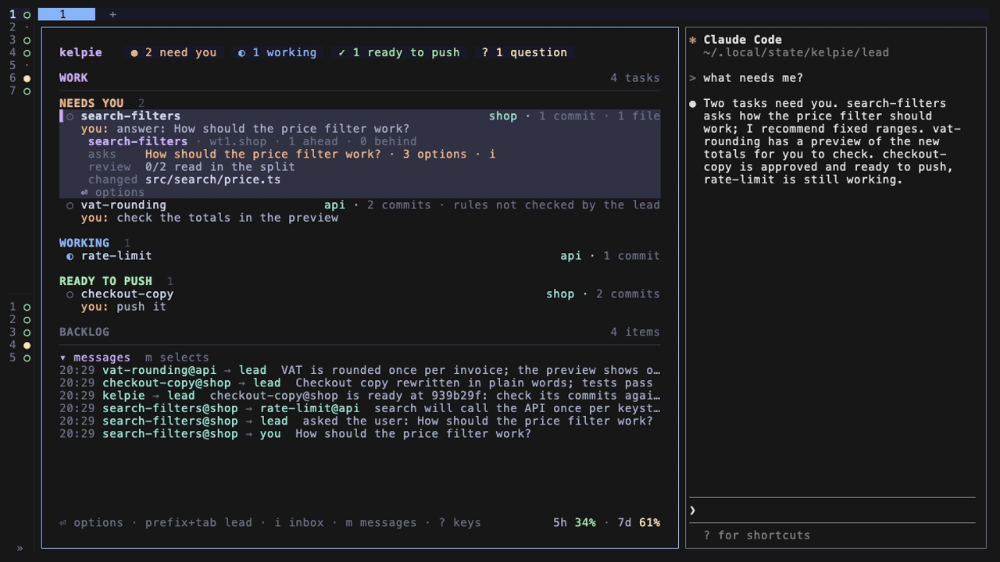

# kebbie

Run many Claude Code tasks at once in [herdr](https://herdr.dev), each in its own git worktree, and land them on your default branch after a review you control.



A kebbie is a shepherd's crook, the Scots word for a staff with a hooked head. herdr holds the agents; kebbie keeps their work moving towards you.

## What you get

- **A task is a worktree, a Space and a Claude.** `kebbie start billing "Fix the rounding in invoices"` takes a free worktree from a reusable pool, puts it on a new branch, opens it as a herdr Space and starts Claude there. Your main checkout stays untouched.
- **A board that sorts work by what it needs from you.** Needs you, working, in review, ready to push, in the order you set. Questions from tasks wait there with their options and a recommendation, and you answer them in one window.
- **A lead Claude that holds the picture.** It finds work in your backlog, writes informed task prompts, relays what one task needs to know from another, and settles questions of method itself, leaving you the ones about what you want.
- **A read-only reviewer on every ready task.** A separate Claude, limited to reading the code, checks a task's commits against your rules before it can be pushed. Send a risky task to a full review and it waits until that reviewer passes its current commits.
- **Review next to Claude.** A split shows the task's changes as diffs in nvim. Comment on a line and the comment is typed into Claude's input box.
- **Work in steps, if you want to.** A task lists its work as steps, one commit each, before it writes code. You accept the commits one at a time and push the accepted ones while it builds the next. Turn it on with `task.steps`.
- **Trunk-based by design.** kebbie rebases a task onto the default branch and pushes its commits there, one task at a time per repo. No pull requests and no merges.
- **Try it on local main first.** In a repo you run from its main checkout, `kebbie stage` puts a ready task's commits on local main, unpushed, until you push main.
- **Your board on your phone.** Connect a kebbie hub through your browser (`H` on the board): the board goes out sealed to your account, and any phone or browser you sign in on with your passkey reads it. The phone only reads, and notifications through the hub are not available in this version.
- **Optional vault integration.** With the [notes-vault-mcp](https://github.com/gronare/notes-vault-mcp) plugin, every task gets a note, edits wait until the problem is written down, pushes are logged, an Areas page shows each repo's state, and kebbie on a second machine sharing the vault asks before it starts a note the first one works on.
- **Update channels and fresh sessions.** Follow tagged releases or the main branch, and the board tells you when a new version is out. One `kebbie update` brings everything along, idle Claude sessions resume on the new code with their conversation intact, and the bugs in kebbie you ran into are rechecked against the new commits.
- **kebbie's own bugs reach its maintainers on your yes.** You see the redacted text before anything is sent. Error signals carry only counts and versions, never your text. A daily install signal carries only a random install id, the version, OS and update channel, so the maintainers can count active installs. `[report] signals = false` turns both off.

## Install

You need macOS or Linux with `git`, `herdr` 0.9.0+, Claude Code, `jq` and `curl`; the review split also needs `nvim` 0.10+, and the history split `tig`.

```bash
curl -fsSL https://kebbie.dev/install.sh | sh
```

The script checks those tools, installs the latest release as a herdr plugin with its prebuilt binary (macOS on Apple silicon or Intel, Linux on x86_64 or arm64), and runs `kebbie setup`. Setup is a guide of seven steps: this machine's name, the agents, herdr's keys, where the backlog lives, the vault and error signals, then one look at everything before it writes any of it, the `kebbie doctor` warnings it can fix among them. It ends with what is still yours to do and an offer to see your board on your phone, then opens your board; inside herdr, that is the lead Space with the lead beside it. It is safe to run again.

Coming from kelpie, kebbie's earlier name? Run the same command: it moves your settings, state and herdr keys over to kebbie and removes the old plugin first.

Press `prefix+space` and tell the lead what you want done. [Your first task](docs/tutorial.md) walks through it step by step.

## Documentation

[The documentation](docs/README.md) is organized as a tutorial, how-to guides, reference and explanation. Good places to start:

- [Your first task](docs/tutorial.md): install to a pushed task
- [Commands](docs/reference/commands.md) and [Configuration](docs/reference/configuration.md)
- [Board keys](docs/reference/board.md)
- [How kebbie fits together](docs/explanation/architecture.md)
- [The trust boundary](docs/explanation/trust-boundary.md): what kebbie guards against, and what it does not
- [Fix common problems](docs/how-to/troubleshoot.md)

## License

MIT, see [LICENSE](LICENSE).
