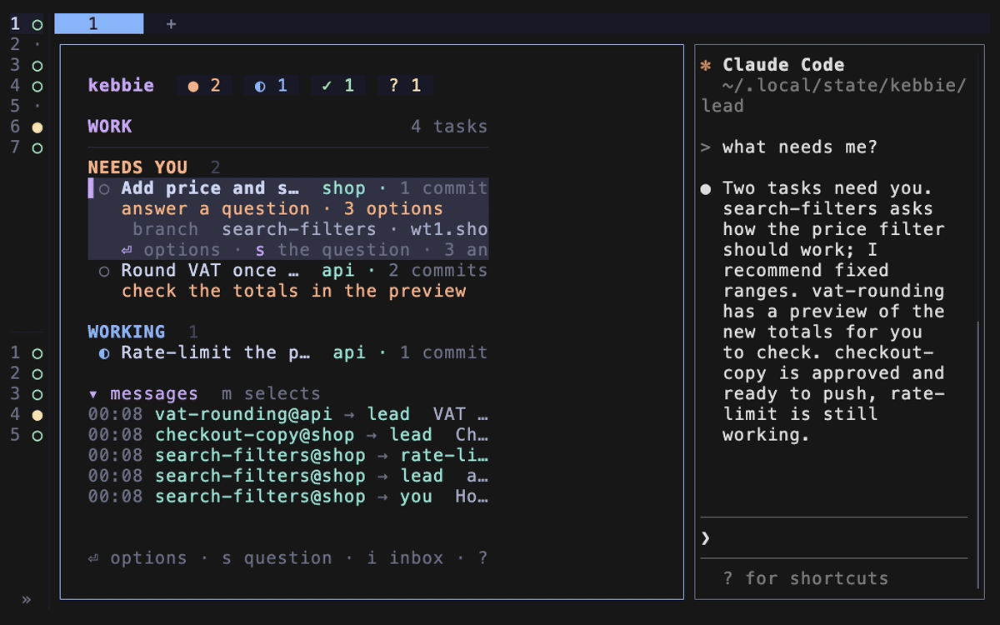

# The lead and away mode

This page explains what the lead holds, where it stops, how away mode keeps work moving, and how the lead restarts.

The lead is the Claude you talk to most. It runs in the lead Space next to the board. Feature work happens in each task's own Space; the lead starts it, steers it and checks it.

## The lead holds the picture for you

With one Claude, you hold the picture. With five, you cannot: you would spend your time switching Spaces, reading scrollback and copying what one session said into another. The lead holds the tasks, repos, plans and decisions, so you can come back after an hour and ask "what needs me?"

## What the lead does

The lead:

- **briefs you** when you arrive: what needs you first, then what is working, in review and ready to push, each with a recommendation,
- **finds work** in your backlog sources and offers two or three candidates,
- **starts tasks** with informed prompts: the ticket, the notes and decisions that bear on it, what other tasks touch, and what done looks like,
- **holds tasks to your rules** when the reviewer's rules check gives no verdict: it checks a ready task's commits against the rules skill, and approves them or sends back what to fix,
- **relays** interface and contract changes between tasks, and brings you what needs a decision,
- **does small cross-cutting fixes** itself, such as a script or a rename across repos.

It does not push, except tasks you gave it permission for.

## It sees everything without being flooded

Every report, message and question passes through kebbie, and the lead gets a copy. The copies do not arrive as chat messages. Each of your prompts to the lead carries the reports and messages it has not seen yet, grouped by task, so its chat stays a conversation with you and its picture stays current.

kebbie sorts what it says to the lead in two:

- **What only informs** never starts a lead turn: a task started, pushed or closed, a review that passed, a rebase or a red CI its task resolves itself, an update. It comes with your next prompt.
- **What asks the lead to act** is delivered: findings to pass on, a rules check the reviewer left, a task's question of method, a push that failed, a prompt on a task's screen, a red CI no task took.

## It waits while you talk with it

What asks the lead to act waits while you are in a conversation with it:

- the lead is mid-turn,
- you prompted it within the last 3 minutes, or its turn on your prompt ended less than 3 minutes ago,
- your own text sits in its input box.

Once you have been quiet for 3 minutes and the lead is idle, what waited goes as one message, grouped by task, so the lead handles it in one turn. A prompt on a task's screen is held too, but it comes first in that message. The message log shows each one as held, with the reason.

In away mode nothing waits: the lead gets each message as it comes.

## It writes at the end of a turn

The lead works without narrating its steps: Claude Code folds its tool calls, and ctrl+o shows all of it. It writes once, when the turn ends, in three short parts, leaving out an empty one:

- **Done**: what landed.
- **Going on**: one line per task.
- **Needs you**: last, each with the exact answer or action it wants from you.

A turn that kebbie's messages started and that needs nothing from you ends on one line, such as "Noted: 3 updates, nothing for you."

## Questions about what are yours, questions about how are not

Questions about what you want go to you: scope, behaviour, a trade-off that is yours, a plan for wide or risky work. A task asks with `kebbie ask`, one question at a time. It opens with a plain sentence on what it is doing, gives options that each say what you get, and the question waits on the board until you answer it there.

Questions about how (method, structure, how to split the work, the order of steps) are not put to you. A task decides them, or asks the lead with `kebbie tell lead`, and the lead answers whether or not you are here. A small, well-defined task builds without asking you to approve a plan.

## Your answer reaches the task as yours

The lead can help you decide, but the answer comes from you, and it reaches the task as `[from you]`. Until you answer, kebbie holds every other message to that task, so nothing starts a turn under an open question.

## Claude's own prompts in a task

A task's Claude can stop on a prompt of its own in its pane rather than through `kebbie ask`:

- a permission question such as "Do you want to proceed?" with "Yes", "Yes, allow reading from web/ during this session" and "No",
- the folder-trust question,
- a menu it puts up.

Until someone answers, the task waits, and the board's `you:` line says so.

## The keeper reads the prompt off the screen

Every 5 seconds the keeper, or an open board with `[keeper] enabled = false`, reads the screen of each task whose Claude waits like this. It sends the lead the question and the options in order, numbered (by kebbie when the menu shows no numbers), with the focused one marked, an id for this prompt, and a mark that it was read from the task's screen. When kebbie cannot read the screen as a menu, such as a question with checkboxes, the lead gets its last lines and the answer stays in the task's Space.

The lead hears of each prompt once. It hears again of a new prompt in the same task, of the same prompt once another showed in between or the task stopped waiting, and of the same prompt asked again after `kebbie choose` answered it.

## You choose, the lead only relays

The lead puts the question to you in its chat, with its recommendation, and names an option that grants more than this one action, such as "during this session" or "don't ask again". It answers only on a choice you type in its chat, with [`kebbie choose`](../reference/commands.md#the-lead-and-away-mode), never on its own, away mode included.

kebbie's settings for the lead do not allow `kebbie choose`, so Claude Code asks you before the lead runs it.

> **Warning:** When Claude Code asks whether the lead may run `kebbie choose`, answer plain "Yes", never "don't ask again". That question is the gate only while your settings hold no allow rule for `kebbie choose`.

`kebbie choose` reads the pane again first and refuses when the prompt is no longer the one you chose from. You can always answer in the task's Space yourself instead.

## Away mode

Away mode lets the lead keep tasks moving while you are gone, without deciding things that are yours. The line it draws is between **how** and **what**:

- A question about method, such as which library, which structure or what order, the lead settles as it does while you are here: with `kebbie decide` when it is on the board. kebbie passes the answer to the task as the lead's call and records it for your summary.
- A question about intent, such as scope, behaviour, a trade-off that is yours or a plan to approve, the lead keeps for you with `kebbie defer`.
- The lead pushes only what your push permissions allow.

## You come back to a summary

When you switch away mode off, kebbie hands the lead what was pushed, what it decided and the questions it kept. The lead writes you a summary in its three parts: what landed and what it decided under Done, the kept questions under Needs you. With a `notify.command`, you hear about landings and kept questions while you are away.

Only you can switch away mode. A task or a message cannot turn it on for you. See [The trust boundary](trust-boundary.md).

## When the API stops a task

A task's Claude can stop because the API failed, not because the work is done: the API is overloaded, a server error, a rate limit, a timeout, a dropped connection, or the plan's usage limit. Claude Code retries some of these itself before it gives up.

Once it has given up, it writes the error into the conversation and the session sits idle. The entry is an assistant entry with `isApiErrorMessage`, its own `error` code and the HTTP status in `apiErrorStatus`. Away from the screen, that is a task that waits for nothing.

kebbie reads that entry and gets the task going again. Every 30 seconds the keeper, or an open board with `[keeper] enabled = false`, looks at each task whose Claude is idle and whose last answer is an API error nobody has typed after.

## kebbie waits out what waiting fixes

| Error | What kebbie does |
| --- | --- |
| Overload, a server error, a rate limit, a timeout or a dropped connection | Types `[from kebbie] … Carry on where you left off.` into the task 1, 2, 4 and 8 minutes after each error, one resume per error. The row says `retrying after overload (2/4, next 21:14)`. If the fifth error comes before Claude has answered once, the task stops. |
| A login, billing, invalid request or refusal error, or one kebbie does not know | Waiting does not fix these. The task goes to Needs you at once with Claude Code's words, the lead gets a line, and `notify.command` gets an `api-error` event. The same happens to a task that kept failing through every retry. |

## The usage limit waits for its reset

kebbie reads the reset from Claude Code's message, such as `You've hit your session limit · resets 5pm (Europe/Stockholm)`, and resumes the task a minute after it. The row says `out of allowance until 17:00`.

A message without a reset kebbie can read takes the reset of the session or week window from the status line instead (`kebbie statusline`). With neither, the task goes to you.

## A resume never types into a draft

- A resume waits while the input box holds text, and its delivery is checked as for any typed message.
- A reply from Claude ends the episode and the count starts again. A prompt from you does too, for a task that waits on you.
- Only tasks kebbie started are resumed, never the lead or your own Claude sessions.
- `[recover] enabled = false` turns it off.

## Hiding the chat

`h` on the board in the lead Space hides the lead's chat, and `h` again shows it. The board then takes the whole width: at 150 columns or more, the wide layout with the detail panel.

- Hiding is herdr's pane zoom on the board: the chat keeps running unseen, at its size, and comes back as it was.
- The state is herdr's, so it outlives a board restart. The status line says `chat hidden` meanwhile.
- `tab`, or `prefix+f` from anywhere, shows the chat again and puts the focus there. Going back to the board leaves it shown.
- `kebbie lead --toggle-chat`, or herdr's `kebbie.chat` action on a key, works as `h` from any Space and takes you to the lead.
- Moving herdr's focus onto the chat by other means while it is hidden zooms the chat instead, as herdr's zoom follows the focus.

## Restarting the lead

The lead reads its role and settings when it starts. `kebbie lead --restart` rewrites them and resumes the same conversation under the new role, so an update never costs you the lead's context.

It goes ahead only while the lead is idle, not waiting on a question, without text you have not sent in its input box and without background work running (`--anyway` cuts that off).

After `kebbie update` you do not run it yourself: the keeper restarts the lead a minute after it is idle and you are out of its pane, and `L` on the board does it at once when you pick `Resume this conversation`. With `restart.auto = false` only `L` and the command do. See [Restarting the lead after an update](updates-and-restarts.md#restarting-the-lead-after-an-update).

### Starting the lead fresh

A long conversation fills the lead's context. `L` on the board opens `Restart the lead`:

- `New conversation`, the first row, starts the lead's Claude on a new conversation, in its folder, with its role, settings and skills as at any start.
- `Resume this conversation` resumes it as before.

`kebbie lead --restart --fresh` starts it fresh from your own terminal. A refusal, for the reasons above, goes by as a toast before the question opens.

The old conversation stays on disk, where `claude --resume` still finds it. kebbie keeps the new one as the lead's, so later restarts resume that. Nothing starts the lead fresh on its own. The lead's role tells it that a fresh start reads only the role and the vault, so it keeps decisions, plans and where each task stands in the vault's notes as it goes.

## The board says when the lead's context fills up

When the lead's context is 85% full or more, the board's Work page says `The lead's context is N% full · L to restart it fresh`.

The share comes from Claude Code's status line for the lead. So it shows only with `kebbie statusline` as your `statusLine` command (`kebbie doctor` checks it). Without that, or before the lead's first reply, there is no line.

## The lead runs in a folder of its own

The lead always runs in `lead` in the state directory, or in `KEBBIE_LEAD_DIR`. Claude Code never remembers that you trust your home folder, so a lead started there would ask "Do you trust this folder?" on every start.

- Before each start of the lead's Claude, from `kebbie lead`, `kebbie lead --restart` or the keeper's restart after an update, kebbie moves the chat pane's shell to that folder with `cd`. herdr then keeps that folder as the pane's, so its own restore after a reboot resumes the lead there too.
- The board always starts in the same folder, and going to the lead restarts a board that runs elsewhere.

## A lead from another folder moves there

A lead that ran in another folder, such as your home folder, keeps its conversation: `kebbie lead --restart` moves the conversation into the lead folder's own Claude Code project and resumes it there.

A lead whose Claude runs outside that folder counts as stale, so the keeper restarts it there once it is idle.

## Related

- [Work while you are away](../how-to/work-while-away.md)
- [Let the lead push](../how-to/let-the-lead-push.md)
