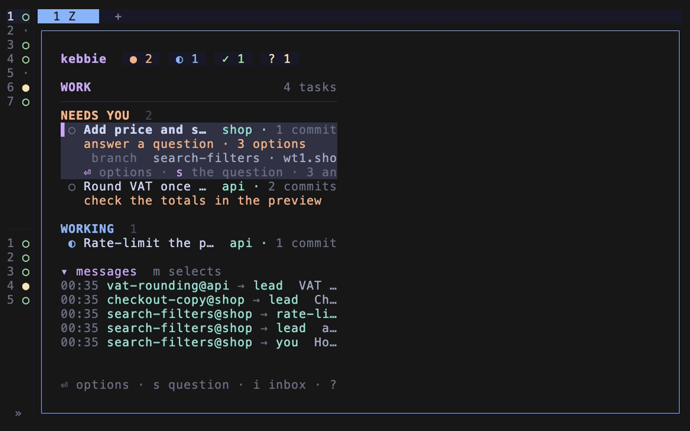

# Updates and stale sessions

kelpie updates itself, its Claude Code plugin and the vault plugin with one command, and then moves the running Claude sessions onto the new code without losing their conversations. This page explains how.

## One install root

herdr installs kelpie into a folder of its choosing; herdr's startup links `~/.local/share/kelpie/current` to it. The binary on your `PATH`, the Claude Code plugin's marketplace and the hooks all point through that link. When `kelpie update` checks out new code there and installs its binary, every part moves together.

## Prebuilt binaries

herdr's install and `kelpie update` both put the binary in place with `scripts/build.sh`, in this order:

1. A `target/release/kelpie` that is newer than every source file is kept.
2. When the checkout is exactly at the `vX.Y.Z` tag of its version and the machine is not on the `main` channel, the script downloads `kelpie-<version>-<target>.tar.gz` from that tag's published GitHub Release, checks it against the release's `SHA256SUMS`, and renames it into place. Releases are built for macOS on Apple silicon and Intel, and for Linux on x86_64 and arm64 (glibc).
3. Otherwise it runs `cargo build --release`.

A download that fails is not tried again for 10 minutes; meanwhile the script builds with `cargo`, or, without it, stops with what to install. A machine on the release channel therefore updates without Rust, while the `main` channel, `kelpie update --from` and an unpublished release build from source. `kelpie doctor` shows on its `plugin binary` line whether the binary was downloaded, and for which tag, or built, and its `cargo` line says whether this machine needs Rust.

## Channels

Each machine follows one channel:

- **`release`**, the default, installs the highest `vX.Y.Z` tag on origin. The install root is checked out detached at that tag. Only tags of exactly `v` and three numbers count, so `v1.4` and `v1.4.0-rc1` are never offered.
- **`main`** follows origin's default branch as it is pushed.

Because the release channel checks out tags in the install root, it refuses to touch an install root with uncommitted changes or one that sits on a branch. Develop in another checkout and try its commits with `kelpie update --from <path>`.

The keeper checks for updates every 6 hours, and the board shows `↑ kelpie <version> · U updates` when the channel has something newer. On a release machine the notice names the new tag, never what main carries.

## Overrides

`kelpie update --from <branch or path>` installs a branch on origin or another checkout's commits, and holds it: a plain `kelpie update` fetches the same branch or checkout again. `kelpie update --check`, `kelpie doctor` and the board say `running <branch or path> @ <sha>, not the channel` until `kelpie update --stable` returns you to the channel. Only commits are installed, so a checkout with uncommitted changes is refused.

## The Claude Code plugin

Claude Code runs a cached copy of each plugin. When the kelpie marketplace was added from `~/.local/share/kelpie/current`, `kelpie update` refreshes that copy from whatever it just checked out.

A marketplace added from GitHub follows GitHub's default branch instead. `kelpie update` updates it only on the `main` channel without an override; otherwise it leaves it and prints the commands that move it to the install root. `kelpie doctor` warns about it too.

## Stale sessions

A running Claude session keeps the code it started with. kelpie calls it stale when it runs older code than it would load if it started now:

- the `claude` binary on `PATH` changed after it started,
- a plugin was updated after it started,
- your MCP server config changed after it started, or
- `kelpie update` ran after it started.

A restart is `claude --resume <session id>` in the same pane, with the process's own flags such as `--model`, `--permission-mode` and `--add-dir`. The conversation stays, and the new process loads the new Claude Code, plugins, MCP servers and hooks. The lead is restarted through `kelpie lead --restart`, which also rewrites its role.

## When restarts happen

With `restart.auto` on, the default, `kelpie update` restarts idle sessions at once, and the keeper restarts each other stale session once it has been idle and out of focus for `restart.idle_minutes`. With `[keeper] enabled = false`, an open board does this instead. The status line shows `↻ N stale` while sessions wait.

A restart never interrupts work:

- A session mid-turn, or the pane you are in, is never restarted on its own.
- A session with background work running, such as a background shell, an agent or a monitor, is not cut off. The board asks you once, as a question.
- A session kelpie cannot restart safely is skipped with the reason: one whose session id herdr does not know, whose command line cannot be read or has an option kelpie does not know, whose Claude runs in another folder than its pane, or whose conversation file is missing.

`kelpie update` ends with one line per session: `restarted`, `restarts when idle`, `you are in it: restarts when you leave it`, `waiting for your answer: background work running`, or `skipped: <reason>`.

## The keeper

The keeper is the background `kelpie keeper` process that runs the restarts, the update check and the delivery of held messages and typed prompts while no board is open. See [How kelpie fits together](architecture.md#the-keeper).

It starts in three places, and each starts it only when none runs:

- herdr's startup hook, when the herdr server starts,
- each board, when it opens and every minute after,
- `kelpie update`, at its end.

`kelpie update` stops the keeper before it restarts sessions, so the two never restart one together, and starts a keeper on the new binary once it is done. A keeper also watches its own binary: once the file it runs from is replaced and holds still for two checks, as after a rebuild or when the `current` link moves to a new install, it exits and starts the new binary in its place.

`kelpie keeper --status` shows whether one runs, its pid, binary and uptime, and each routine's last run; `kelpie keeper --stop` stops it after the routine under way.

## Related

- [Switch update channel](../how-to/switch-update-channel.md)
- [Try unreleased code](../how-to/try-unreleased-code.md)
- [Turn off automatic restarts](../how-to/turn-off-automatic-restarts.md)
