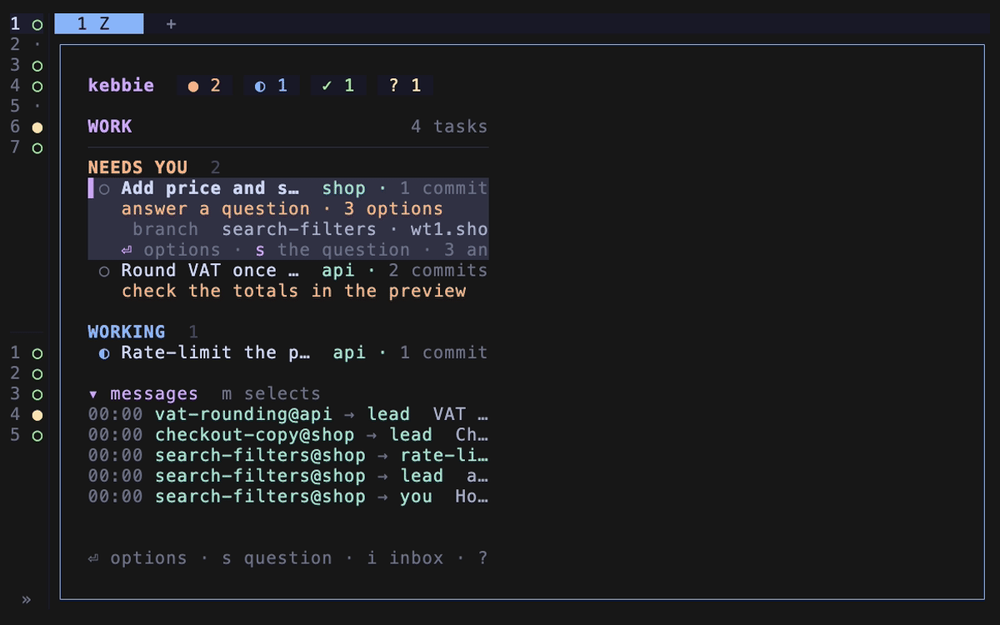

# Add a routine

Have kebbie run a check on a schedule, as a task that reports what it finds or proposes a plan.



## Add one from the board

1. Press `3` on the board for the Routines page.

2. Press `n`.

3. Answer the five steps: what it should do, the repo, when (`07:00`, `mon 08:00` or `every 6h`), what it may do, and its name.

4. Check the table it shows. Press `y` to add it to config.toml, or `g` to add it and run it at once.

If you work in a shell, add it with:

```bash
kebbie routine add --title "Cluster health" --repo infra --every 6h \
  "Check the cluster with kubectl: every node Ready, no pod crash-looping, every volume healthy."
```

If you would rather ask the lead, say it in your words. It shows you the routine's title, repo, schedule, mode and push, and adds it with `kebbie routine add` once you say yes. It sets `--push` only when you ask for it.

If you write the table yourself, or keep a routine in a repo's own config, follow the examples below.

## Check a cluster's health every six hours

The cluster's manifests live in a gitops repo, `~/code/infra`, so the routine goes in that repo's config and runs there.

1. Add a `[[routines]]` table to `~/.config/kebbie/repos/infra.toml`:

   ```toml
   [[routines]]
   id = "cluster-health"
   title = "Cluster health"
   every = "6h"
   prompt = """
   Check the cluster with kubectl: every node Ready, no pod crash-looping or pending for long, \
   every volume attached and healthy, and every gitops bundle reconciled.
   """
   ```

   `mode` is left at `"report"`: the task looks and changes nothing.

2. Check it parses:

   ```bash
   kebbie doctor
   ```

3. See when it runs:

   ```bash
   kebbie routines
   ```

4. To try it at once, start a run now:

   ```bash
   kebbie routine run cluster-health
   ```

When all is well, the task closes itself with `kebbie routine ok` and you hear nothing. When it finds something, it waits under Needs you with a card listing each finding, and your notify command gets a `routine-findings` event.

## Propose dependency updates every Monday

1. Add a routine to the app's repo config, `~/.config/kebbie/repos/app.toml`:

   ```toml
   [[routines]]
   id = "dependency-updates"
   title = "Dependency updates"
   at = "mon 07:00"
   mode = "plan"
   prompt = "Find the outdated dependencies, read their changelogs for breaking changes, and propose which to update and how."
   ```

2. Check it:

   ```bash
   kebbie routines
   ```

3. On Monday at 07:00, or when the machine wakes after it, the task investigates and puts a plan to you on the board. Approve it there.

4. The task makes the updates in commits and reports ready. Push them as any task.

## A routine in config.toml

A routine in `~/.config/kebbie/config.toml` names its repo, by folder name or path:

```toml
[[routines]]
id = "disk-space"
title = "Disk space"
repo = "~/code/infra"
at = "07:00"
prompt = "Check free disk space on every node and flag any under 15 percent."
```

## Turn one off

Press `p` on it on the Routines page, or set `enabled = false` in its table. `kebbie routine run <id>` still starts it by hand.

See also: [Routines](../explanation/routines.md), [`[[routines]]`](../reference/configuration.md#routines).
