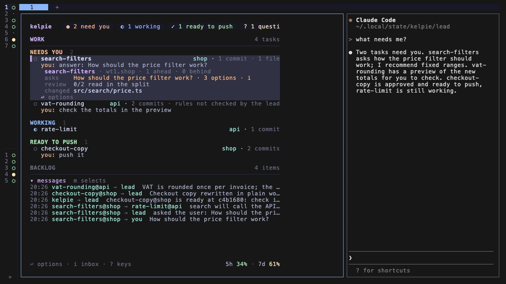

# Answer a task's questions

Answer the questions your tasks ask through the board, each with options and a recommendation, all in one window.



1. Press `i` on the board. The inbox opens with the waiting questions on the left and the selected question's detail or plan in the middle.

2. Pick an option with `↑` `↓` or `j` `k`. In a plan, `←` `→` pick too. The cursor starts on the recommended one, marked `recommended`.

3. To add a comment, start typing, or press `tab` to reach the comment field.

4. Press `⏎`. The answer reaches the task as `[from you] <answer>`, and the lead gets a copy.

If no option fits, select "In my own words" and write the answer as the comment.

If it is a plan, the options are approve, approve with a comment, ask for changes, and reject with a comment.

If a plan, or a question taller than its window, does not fit, `PageUp` and `PageDown` scroll it, in every question window.

If you want the asking task's Space, press `g`. When you settle the question there instead, close it on the board with:

```bash
kebbie answered billing
```
