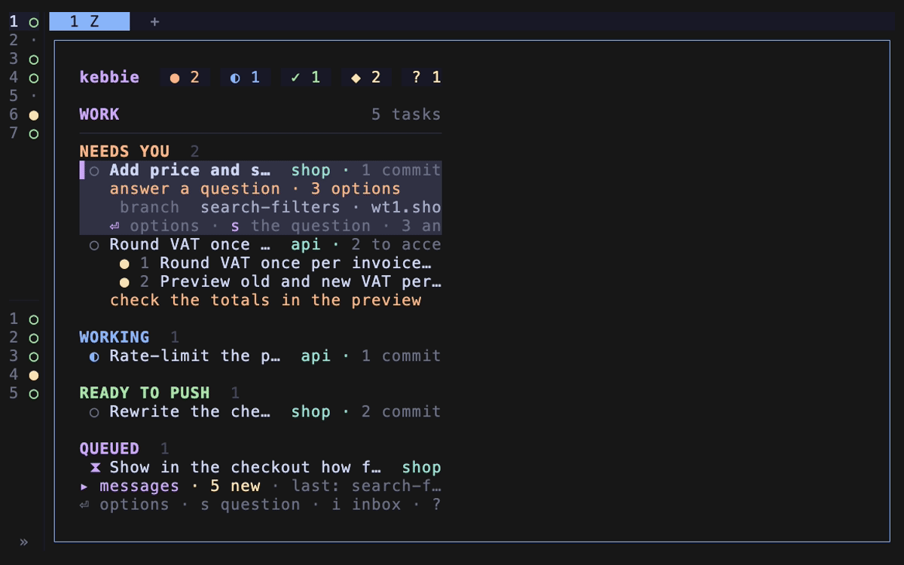

# Finish or throw away a task

Close a task you pushed, drop one you no longer want, or reset one to start over.

| You want to | Run | Board |
| --- | --- | --- |
| Push it and close it | `kebbie push billing` | `p`, then `y` |
| Close it after pushing it some other way: cherry-picked, squashed, or through a pull request | `kebbie done billing` | `d`, then `y` |
| Throw it away when it has no unpushed work | `kebbie drop billing` | `x` |
| Throw it away with its uncommitted work and unpushed commits | `kebbie drop billing --force` | `x`, then confirm the force |
| Stop it for good and put its backlog item back | `kebbie reset billing` | `z` |

Each one frees the worktree for the next task. Run without a name from inside the task's worktree, these act on that task.

## A push on GitHub waits for CI

When origin is on GitHub and `gh` is logged in, a push does not close the task straight away. The task waits under CI running until every workflow run for the pushed commit is green, then closes as done.

If a run fails, the task moves to Needs you with the workflow and job that failed, and its Claude gets the end of the failing log to fix it. Push the fix the usual way, or close the task with `d` if you choose to leave CI red.

`kebbie ci` lists what is watched, and [`ci.watch`](../reference/configuration.md#keys) turns it off. Without `gh`, or with origin elsewhere, the push closes the task right away and says why CI was not watched.

## When done refuses

`done` refuses while a change on the branch is not on the default branch, and names the missing commits. With the vault, it also waits for the task's note to have its solution and decisions.
