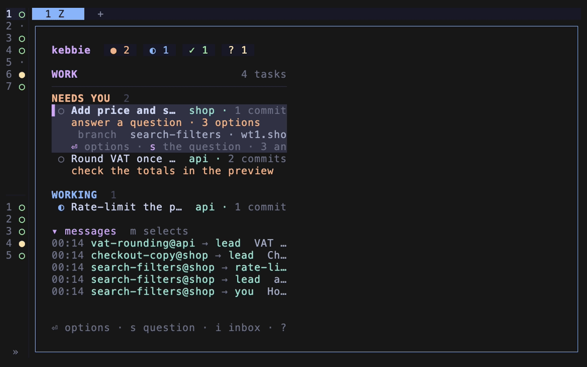

# Review a task's changes

Read a task's diff next to its Claude, step by step, and send it comments line by line.

1. Select the task on the board and press `r`. A split opens next to Claude: kebbie's view with the task's steps and files on top, the diff in nvim below. It opens on the first step waiting for your accept.
2. Read the step's commit message, then pick a file with `↑` `↓` or a click. nvim shows its diff at once.
3. Press `tab` twice to go to the diff. Press `c` on a line, or drag over lines and press `c`, and write your comment. It is typed into Claude's input box as `path:line in <sha> — text`, not sent.
4. Press `tab` to go back to the steps. Press `r` on a file you have read.
5. Press `a` to accept the step's commit. The view moves on to the next step waiting.
6. Switch to Claude's pane and press Enter to send all your comments at once.

- If you are in the task's Claude, `/kebbie:review-split` opens the same split.
- If you want the whole branch as one diff, press `←` until `all` is selected, or click `all`.
- If you want more room for the files, press `m` to hide the commit message.
- If you want the files beside the diff, widen the split to 120 columns or more: nvim moves to the right of the view.
- If you want to edit a file yourself, press `o` in the diff. Save, then `ctrl-q` back to the diff; Claude is told which lines you edited.
- If you want to copy lines from a diff, drag over them, or press `V`, then `y`. Over SSH the copy reaches your own machine's clipboard through the terminal.
- If you want the split to open on every task automatically, turn on `auto_open`: `/plugin` → Installed → kebbie → Configure.

Every key: [Review split](../reference/review-split.md).
