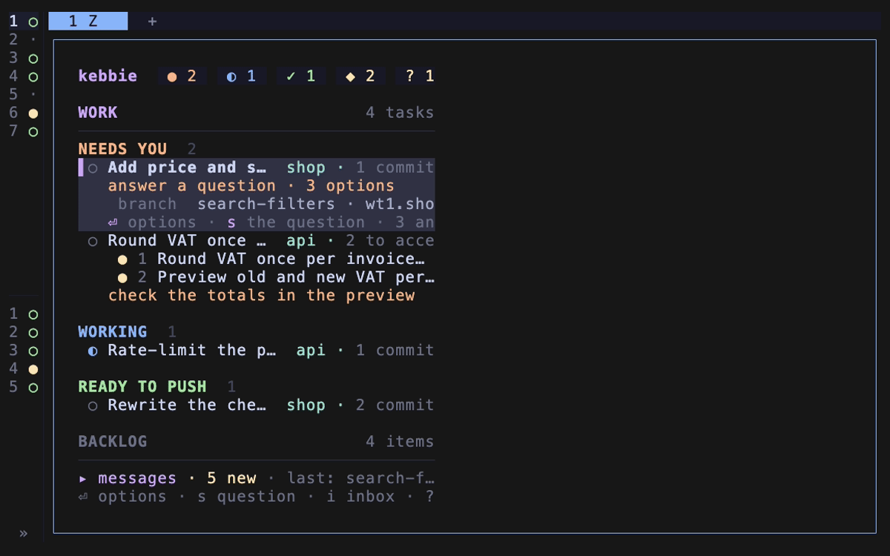

# See your board on your phone

Follow your tasks from your phone through a [kebbie hub](https://github.com/gronare/kebbie-hub): every task grouped as on the board, and the questions waiting for you with their options.

It works on any phone or browser you sign in on with your passkey. The phone reads; you still answer and push on the machine.



## What the hub sees

Every board the machine sends is end-to-end encrypted to your account's key and signed by the machine. Only your passkeys unlock that key, so the hub relays the board without being able to read it.

Nothing the hub sends can start anything on the machine. The board carries task names, repo names, summaries and questions, never a local path, a host name or a dev server address.

## What you need

- A browser where you can sign in to the hub with a passkey, or make an account there.
- The keeper running on the machine (`kebbie doctor` says so); it posts the board. With `[keeper] enabled = false`, an open board posts it once a minute instead.

## Connect the machine

1. On the board, press `H`. Or, in your own terminal, run:

   ```bash
   kebbie hub connect
   ```

2. Choose the hub:

   - `k`: the kebbie hub, at `hub.kebbie.dev`, which is free to connect and read.
   - `o`: your own, a server you run kebbie-hub on. Give its address. kebbie checks that it answers as a kebbie hub over `https` (`http` only for a hub on this machine), says `✓ answers as a kebbie hub`, then saves it as [`[hub] url`](../reference/configuration.md#keys).

   In a terminal `↑` `↓` move the highlight and Enter chooses, `k` and `o` choose at once and `esc` cancels. Without a terminal kebbie asks for `k` or `o`, with `k` the answer to Enter. With `[hub] url` set, kebbie connects there without asking.

3. Name the machine, once. The phone shows it by its one name, [`[machine] name`](../reference/configuration.md#keys), the same name your other machines on the vault see it by.

   Set already, kebbie uses it; `--name <name>` sets it; otherwise kebbie asks, and Enter keeps the host's short name. kebbie writes the name to config.toml once the hub took it.

4. Open the link. kebbie shows a card with a QR code of the link, the machine and the hub, a code such as `Z78K-XF53` and how long the code has left. Nothing opens by itself:

   - press Enter to open the link in your browser (not over SSH), and the card's `⏎ open in browser · or scan with your phone` becomes `✓ Opened in your browser`;
   - or scan the QR code with your phone.

5. On the page, check that it shows the same code.
6. Sign in with your passkey, or make an account.
7. Press Connect.

kebbie waits up to 10 minutes and ends on a card saying the machine is connected to the hub and that you sign in with your passkey on any phone or browser to see its board. Or it ends in one line: cancelled in the browser, or the code expired. `kebbie hub status` shows the account's id and the fingerprints of the two keys the machine pinned.

- If the camera keeps reading the text beside the QR code instead, frame the code alone, or set `KEBBIE_QR=octant` when your terminal draws block characters well.
- If kebbie runs without a terminal, it prints the whole link and opens nothing.
- If this machine has no browser, `c` copies the link to paste elsewhere. The link shown under the card stops at its `#`, since what follows is the secret that ties your browser to this machine.
- If config.toml is a link, say into a dotfiles repo shared by several machines, kebbie never writes it: it says which line to set there or in a config.toml of this machine's own.

### How the QR code is drawn

It is drawn in the terminal's own colours, the text colour making the light modules and the background the dark ones, so it reads dark on light in a dark theme. In Ghostty, kitty and WezTerm it is in octant blocks; in other terminals it is drawn in braille.

### How the key reaches the machine

When you press Connect, the browser hands the machine your account's key, with no digits to compare. The link carries a secret that never reaches the hub, and the machine pins the key only when the browser's commitment to it matches that secret. From then on the machine seals every board to your account.

The machine's keys and the hub's token for it stay in `hub/` in kebbie's state directory, readable by you alone. Nothing prints them.

> **Warning:** A machine approved by typing its code on the page, without the link, holds no account key, so no browser can read its board and kebbie posts none. kebbie says so on the card, in the board's `H` window, in `kebbie hub status` and in `kebbie doctor`. Connect it from the link: `kebbie hub leave`, then `kebbie hub connect`, and open the link it shows.

### Rename the machine

Change `[machine] name`, or press `n` in the board's `H` window. The keeper renames it on the hub with its next post, and `kebbie hub status` does it at once. Your phone shows the new name when it next reads the board.

- If the hub is unreachable, `kebbie hub status` and `kebbie doctor` show the name the hub still has and why the rename failed.
- If `[machine] name` is unset, the hub keeps the name the machine connected with, even when the host is renamed.

## See the board on your phone

1. Open the hub in the phone's browser, `hub.kebbie.dev` or your own.
2. Sign in with your passkey.

The phone shows the board of every machine your account connected. Nothing is added on the machine: any phone or browser you sign in on reads the boards.

Reading needs a passkey that can unlock the account's key, such as one in iCloud Keychain, Google Password Manager or 1Password. A passkey that cannot signs in, and the page says it can't unlock the boards.

To keep the hub on the phone's home screen:

- iPhone: in Safari, tap Share, then **Add to Home Screen**.
- Android: in Chrome, open the menu and tap **Add to Home screen** (or **Install app**).

## Notifications

Notifications through the hub are not available in this version: the phone shows the board when you open it, and nothing is pushed to it. To hear when a task needs you, set a [notify command](get-notifications.md) on the machine.

## Check that it works

```bash
kebbie hub status
```

It shows the hub, the machine's name, the account whose key the machine pinned with the key's two fingerprints, and when the board last went out.

- The board's `H` window shows the machine on its hub with a dot: green with when the board last went out, red with the reason when it does not.
- `kebbie doctor` has a `hub` line: connected, reachable, and the last post.

The keeper posts the board when it changes and once a minute while nothing does, so the phone can tell that the machine is awake. A machine not heard from for three minutes shows as asleep. The hub keeps a board a day at most, so the once-a-minute post keeps an awake machine's board fresh, and a machine that has slept longer shows as asleep with when it was last seen.

## When the subscription lapses

On a hub with plans, such as the kebbie hub, the hub stops taking the machine's board while the account's subscription is not active. kebbie then says `Your kebbie hub subscription isn't active:` with the link to start it: in a line on the board, in the `H` window, in `kebbie hub status` and in `kebbie doctor`.

Everything on the machine keeps working, and the board goes out again with the next post once the subscription is active.

## Scripts: join with a code

For a setup without a browser, a hub you run yourself mints a join code for a machine with `kebbie-hub admin join-code`. Then, on the machine:

```bash
kebbie hub join https://hub.example.com <join code>
```

It names the machine as `kebbie hub connect` does, and a join code works once. A machine that joined this way belongs to no account, so it holds no account key and no browser reads its board.

## When the hub moves

kebbie follows the hub to another port or path on its own host. When it moves to another address, kebbie refuses to follow by itself, and `kebbie hub status` shows where the hub points.

1. Check that address.
2. Move to it:

   ```bash
   kebbie hub move https://hub.example.net
   ```

kebbie checks only that the address answers as a hub, then sends the machine's token there with every post.

> **Warning:** Whether it is your hub is yours to check: move only to a hub you run or trust.

## Leave the hub

```bash
kebbie hub leave
```

Or press `l` in the board's `H` window, then `y`. It forgets the keys, the token and the account key, and posts no more boards. The hub keeps a row for the machine, shown as asleep, until you remove it in the web app or the hub's admin removes it.

Every command: [The hub](../reference/commands.md#the-hub).
