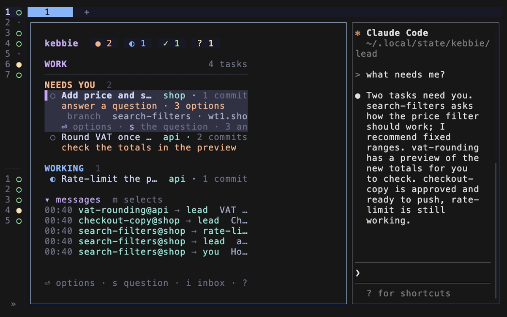

# Work while you are away

Let the lead keep tasks moving while you are gone, and get a summary when you are back.



1. Before you leave, give push permission where you want work to land without you: `a` on a task, or `a` on a repo in the Areas page. See [Let the lead push](let-the-lead-push.md).

2. Optional: set a [notify command](get-notifications.md) so you hear about landings and kept questions.

3. Switch away mode on: press `A` on the board, or run:

   ```bash
   kebbie away on
   ```

   While it is on, the lead answers questions about how itself and keeps questions about what you want for you.

4. When you are back, switch it off: `A` again, or run:

   ```bash
   kebbie away off
   ```

   The lead writes you a summary: what landed, what it decided and why, and what waits for you, the kept questions first. Answer those with `i` on the board.

- If a task should run unattended, start it with a permission mode that does not stop for prompts, for example `kebbie start <name> "<prompt>" --mode auto`.

See also: [The lead and away mode](../explanation/lead-and-away-mode.md).
