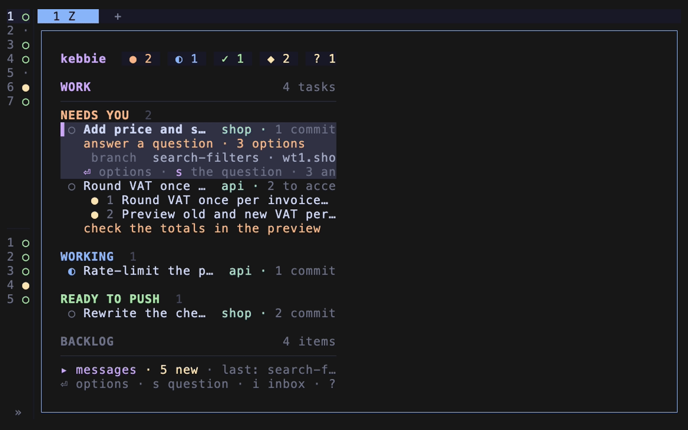

# Board



The board runs in the lead Space, as a popup over any Space with `prefix+t`, or in the current pane with `kebbie board`. A board you quit in the lead Space starts again the next time `prefix+space` takes you there. `?` on the board lists every key.

## Layout

| Part | Shows |
| --- | --- |
| Status line, top | The page tabs, `1 Work  2 Areas  3 Routines`, with `⚠N` on Routines while N routine runs wait for you with findings. Counts of tasks that need you, are working, are to review, are ready to push and wait for CI; waiting questions; `! N bugs to send · B` while bugs in kebbie you ran into wait for you to send them to its maintainers; plan usage; `↻ N stale` while Claude sessions wait to be restarted; `☾ away` in away mode; `chat hidden` while the lead's chat is hidden; `↑ kebbie <version> · U updates` when a newer version is out; `⇣ updating kebbie · U` while an update whose window you hid runs, and `✓ kebbie updated · U` once its summary waits for you. |
| Lead line, under the status line | While the lead counts as stale: `↻ The lead restarts on the new kebbie when it's idle · L restarts it now`, `↻ The lead runs the old kebbie until you restart it · L restarts it` with `restart.auto` off, or `↻ The lead's restart on the new kebbie failed · L tries again`. A narrow board takes a shorter wording, never a cut one. See [Restarting the lead after an update](../explanation/updates-and-restarts.md#restarting-the-lead-after-an-update). |
| Context line, under it | While the lead's context is 85% full or more: `The lead's context is N% full · L to restart it fresh`, `Lead context N% · L` on a narrow board. A click on it asks as `L` does. No line while the share is unknown. See [Starting the lead fresh](../explanation/lead-and-away-mode.md#starting-the-lead-fresh). |
| Hub line, under it | While the hub refuses the board for a lapsed subscription: `Your kebbie hub subscription isn't active: <link> · H hub`. |
| Work, left | Tasks from every repo with a worktree pool, grouped, in the order of [`board.groups`](configuration.md). A task's halves in other repos sit next to each other. Under the tasks: the bugs to send while `B` shows them, `✓ Fixed in kebbie <version>: N bugs you ran into` with their titles after an update's recheck fixed some (`i` shows the list and clears the line), and the main checkouts with files changed outside any task. |
| Backlog, right | An ONGOING section of vault project notes in progress (status active or draft) when the vault is on, and the items from the configured sources, by priority. ONGOING sits above the items, below them or nowhere, by [`board.backlog.ongoing`](configuration.md). |
| Messages, bottom | What sessions tell each other, newest last. |

In a narrow pane the two columns stack, and the status line keeps only the counts that are not zero, without their words, so the page tabs still fit.

A task row shows its commits, uncommitted and untracked files, and how far it is behind the default branch. Behind is information only: push rebases it when its turn in the push line comes, `e` rebases now, and a task you keep rebased on main catches up by itself. The open task says `follows main` while that is on. A task whose Claude runs in bypass permissions mode says `bypass` on its row and `bypass permissions: Claude asks for no permission` when open. Under it, a `you:` line gives your next step from the task's last report; while Claude waits on a prompt of its own, such as a permission or trust question, it says `answer Claude's prompt in its Space (g) or through the lead`: `g` takes you there, and the lead has the question and its options in its chat (see [Claude's own prompts in a task](../explanation/lead-and-away-mode.md#claudes-own-prompts-in-a-task)). While its dev server runs, a `web` line shows the server's address as a link. While a push waits for the task's Claude to test the files the default branch changed under it, the row and the open task say `push waits for tests · you`, or `· lead` when the lead pushed; kebbie pushes once the task reports ready with the same commits.

The selected task opens in place with its review progress, its question and options, its report, its latest test run, and a warning about files changed in a main checkout outside any task.

The `tests` line shows the last test command the task's Claude ran, as kebbie recorded it (see [`kebbie evidence`](commands.md#kebbie-evidence-name---json)):

| Line | Means |
| --- | --- |
| `✓ cargo test · 493 passed · at a1b2c3d`, green | It passed on the code the branch holds now, and the worktree has no uncommitted changes. |
| `○ cargo test · 493 passed · at a1b2c3d, code changed since`, yellow | It passed, but a commit changed the code after it, or the worktree has changes it did not run on. |
| `✗ cargo test failed · 2 failed · at a1b2c3d`, red | The latest run failed. |

No line means no test run is recorded. The wide panel shows the same line.

## Groups

| Group | Contains |
| --- | --- |
| Needs you | A question on screen, such as a permission or trust prompt, whatever else the task is doing; an open question from `kebbie ask`; messages held behind a draft in its input box; a task whose commits are on the default branch that kebbie does not close by itself, marked `landed on main · d closes it` beside a question, or `landed on main, but its worktree has uncommitted changes or a stash` (see [`kebbie done`](commands.md#kebbie-done-name)); a task that reported needs-you, or ready with nothing committed; a task whose turn ended without a report even after kebbie asked for one; a task whose CI failed after a push of only some of its commits, marked `CI failed: <workflow> · <job> · <step>`, and `its Claude says outside the code: <reason>` once its Claude has said so (`C` dismisses it); a push under way whose Claude reported needs-you; a push that left its repo's push line unpushed, marked `out of the push line: <why>` (its Claude did not report ready within 30 minutes, it reported needs-you, or it has commits nobody checked since you chose push; push again and it joins the end of the line); a push or close kebbie could not finish; a pushed task whose CI gh has not been able to read for 15 minutes, its row marked `gh cannot read it: <error>` meanwhile; a task an API error stopped that kebbie will not resume, marked `stopped by <reason>: <Claude Code's words>`. Open questions first. |
| Working | Started with a prompt, or at work since its last report or since you answered it; a pushed task whose CI is green and that kebbie closes once its note is written, marked `pushed · kebbie closes it`. kebbie resuming it after an API error leaves it here, marked `retrying after overload (2/4, next 21:14)`, `out of allowance until 17:00`, then `resumed after …` until Claude answers. See [When the API stops a task](../explanation/lead-and-away-mode.md#when-the-api-stops-a-task). |
| To review | Reported ready and sent to the reviewer, waiting for a pass on its current code. |
| Ready to push | Reported ready with its commits, marked `reviewer checking rules` while the reviewer checks them against the rules skill, `rules: N breaks` when it found some, and `lead checking rules` when the reviewer gave no verdict and the lead checks them; an approved row says nothing of the rules, and with the count of uncommitted files when you edited after the report. How far it is behind the default branch does not matter. A push under way stays here, marked `pushing for you · <what it waits for>`: its turn, as `2nd in line after <title>` while other pushes of its repo go first and `kebbie pushes it now` at the head; the tests for files the default branch changed under it, a conflict, or a fix for CI that failed after the push. A task on local main stays here too, marked `on local main · waiting for your push`, until main is pushed and it closes as landed. Each repo pushes one task at a time, in the order you pushed them, and rebases a task only when its turn comes; a head whose Claude works keeps its place while the line waits for it, for up to 30 minutes. See [Pushing](../explanation/trunk-based.md#one-push-line-per-repo). |
| CI running | Pushed, with its worktree kept until every workflow run for the pushed commit is green; then it closes as done. A report its Claude writes meanwhile keeps it here unless it says needs-you or blocked. The row names the runs, and the open task links each run's page. See [`kebbie ci`](commands.md#kebbie-ci---json). |
| Waiting for work | Started without a prompt, or whose start never reached its Claude; reported blocked on something outside you; pushed in part with `keep open` and nothing left on top; or kept open and its red CI dismissed. |
| Queued | Waiting to start after other tasks, with no worktree, Space or Claude. The row, marked `⧗`, carries a title from its backlog item or the first sentence of its prompt, which it keeps once started until Claude names the session. Its second line, whole, says why it waits and what starts it: `Waits for Billing totals (ready to push): it uses the rounding field. Starts by itself once it is pushed and CI is green.` The reason is the one given with `kebbie start --why`. It starts by itself once each of them has ended as done. A task queued with `--at` waits for that time as well, or only for it, and the row says when: `Starts 15:00 today.`, `Starts Fri 24 Oct 09:00.` When one of them is dropped, reset or gone, the row moves to Needs you with the reason instead. See [`kebbie after`](commands.md#kebbie-after-name). |

kebbie keeps one phase per task, and only what changes it writes it: its start, the first prompt it takes up, its report, its question and your answer, a push and its hand-over, a CI verdict, an API error it will not resume. The group follows that phase. Whether its Claude is mid-turn shows as the row's `◐`, never as a move: a task reading kebbie's update notice, or one the lead tells to fix a commit, stays in its group until it reports. Only a prompt of your own, typed into its Space or sent as your answer, moves a task that waits for you or for work under Working; a message from the lead, another task or kebbie does not. Four things put a task under Needs you whatever its phase, for as long as they last: Claude's own prompt on its screen, an open question, messages held behind your draft, and landed work kebbie leaves to you.

## Keys

`⏎` opens the options for the selected row. Each option's letter also works directly. Every key that is a plain character can be moved in config.toml's `[keys]`; help, hints and messages then show the key you chose. See [Keys](#keys-in-configtoml).

### Everywhere on the Work page

| Key | Action |
| --- | --- |
| `⏎` | Options for the selected task or backlog item. |
| `↑` `↓`, `j` `k` | Move. |
| `←` `→` | Switch between Work and Backlog. |
| `1`, `2`, `3` | The Work page, the Areas page, the Routines page. |
| `tab` | Move focus to the lead's chat, showing it first when it is hidden. |
| `h` | Hide the lead's chat, or show it again: the board takes the whole width while the chat runs on. Only on the board in the lead Space. See [Hiding the chat](../explanation/lead-and-away-mode.md#hiding-the-chat). |
| `i` | The inbox: the questions waiting on you, opened at the first. Works on the Areas page too. |
| `m` | Messages: once shows them on one line, again opens them, again hides them. |
| `B` | Bugs in kebbie you ran into, to send to kebbie's maintainers: shows the list under Work with the first one selected, and hides it again. Hidden at first; while any wait, the header counts them, such as `! 2 bugs to send · B`. The board remembers whether it shows. See [Send it to kebbie's maintainers](../how-to/report-a-problem-with-kebbie.md#send-it-to-kebbies-maintainers). |
| `H` | The [hub](#the-hub-window) window, to see this board on your phone. |
| `n` | New task: a name, then an optional prompt. Starts in the background. In the Backlog column, a new item. |
| `/` | Filter the selected column: type part of a name, `⏎` keeps the filter, `esc` clears it. |
| `R` | Ask the lead to refresh the backlog. |
| `A` | Away mode on or off. |
| `U` | Run `kebbie update` in a window that shows each step, with a bar while kebbie builds or downloads; `esc` hides it while the update goes on, and `U` opens it again. Done, it shows what's new and fixed from kebbie's release notes and what restarts; `d` shows the details, any other key closes it. See [What an update shows](../explanation/updates-and-restarts.md#what-an-update-shows). |
| `L` | Restart the lead on the installed kebbie now, whether or not the lead line shows. It opens `Restart the lead` with two rows: `New conversation`, selected, starts its Claude fresh from its role and the vault, the old conversation left on disk; `Resume this conversation` restarts it on the same one, as to pick up a new Claude Code. `↑` `↓` (or `j` `k`) move, `⏎` or a click picks, `1` and `2` pick directly, `esc` cancels. The result goes by like the board's other results. Refused with the plain reason as a toast, before it asks, while the lead works, asks, holds text you have not sent or has background work running; press it again later. See [Starting the lead fresh](../explanation/lead-and-away-mode.md#starting-the-lead-fresh). |
| `?` | The keys window: every key on the page you are on, one short line each, grouped by what you want to do, under the title `keys · work`, `keys · areas` or `keys · routines`. On a screen about 114 columns wide or more it is two columns; narrower, up to three keys a row, scrolling with `↑` `↓` and `pgup` `pgdn` when it does not fit. A moved key shows as you set it, and `↑` and the version beside `U` when there is a newer one. Any other key closes it. |
| `esc` | One step back: close a window, a menu or the filter. At the top, close the board when it is a popup; on the full board it does nothing. |
| `q` | Close the current view, like `esc`. At the top, close the popup; on the full board it says that `ctrl+c` twice quits. |
| `ctrl+c` | Twice within 2 seconds quits the board. The first press says so. |

On a queued row, `⏎` offers three things: `g` starts it now from the default branch, without the changes of what it waits for, its Claude told what is missing; `l` sets when it starts (`15:00`, `tomorrow 09:00`, `fri 09:00`, `24 oct 09:00`, `in 2h`), and it starts then once what it waits for is done too; `x` drops the wait, so it never starts and its backlog item goes back to the backlog. `g` and `x` ask first.

A question that asks first, as reset, drop and done do, takes `y` to go ahead and `n` or `esc` to cancel. Any other key keeps the question and says "press y or n".

### On a task

| Key | Action | Offered when |
| --- | --- | --- |
| `s` | Answer its question: the questions window, at this task's question. | It has an open question. |
| `g` | Go to its Space. On a task whose Space or Claude is gone, restart it and resume its conversation. | Always. |
| `c` | Chat: message its Claude. | Always. |
| `r` | Open the review split next to its Claude, or go to the one already open in its Space. | Always. |
| `s` | Show the sign-off card. | It has a card and no open question. |
| `w` | Start or stop the dev server. | `worktree.dev_server` is set. |
| `b` | Start or stop the worker. | `worktree.dev_worker` is set. |
| `1`–`9` | Open one of its links in the browser, listed under LINKS by what each is: the running dev server, each CI run, a mock, a pull request or another address its report or card names, and its vault note, which opens in Obsidian. The highlighted link's whole address shows on the description line. Where the board has no browser, as over ssh, it says the address instead. | It has that link. |
| `v` | Send to review; on a task in review, withdraw it. | It has commits and Claude is not mid-turn. |
| `e` | Rebase onto the default branch now, in the background, without pushing; the result shows when it is done. A conflict goes to its Claude, as with [`kebbie land`](commands.md#kebbie-land-name). | It is behind the default branch and Claude is not mid-turn. |
| `t` | Ask its Claude to tidy its commits by the rules skill. | Claude is not mid-turn. |
| `p` | Push: open the push window; `y` or `p` there puts the task in its repo's push line, which rebases it onto the default branch and pushes it when its turn comes, at once when the line is empty. On a task already in the line, `p` takes it out again, unpushed; not a fix for red CI, whose commits are on the default branch already (`C` dismisses that). `e` is not offered while a task is in the line. | Claude is not mid-turn and it is not waiting for the reviewer. |
| `M` | Put on local main to try it: its commits go on the main checkout's local default branch, unpushed, after the tasks staged before it, and the row says `on local main · waiting for your push`. On a staged task, take them off again; the other staged tasks stay. See [`kebbie stage`](commands.md#kebbie-stage-name). | To put on: the repo sets `worktree.stage_on_main`, it has commits, Claude is not mid-turn, it is not waiting for the reviewer and has no CI watch. To take off: always. |
| `C` | Dismiss the red CI of a pushed task whose failure is not the code's: kept on record with the reason its Claude gave, and the task closes once its commits are on main. Asks first. Yours alone. | The task's CI failed. |
| `d` | Done: close a task you already pushed elsewhere and free its worktree, also one under CI running or with failed CI you choose to leave. Asks first. The keeper closes a landed task by itself; `d` is for the ones it leaves to you. | Claude is not mid-turn. |
| `a` | Let the lead push it, or take that back. `done`, `drop` and `reset` take it back too. | It is a task. |
| `u` | Keep it rebased on main, or switch that off; `●` marks it on. When main moves, the keeper rebases it, never pushes it. See [`kebbie follow`](commands.md#kebbie-follow-name-onoff). Off by default; `done`, `drop` and `reset` switch it off. | It is a task. |
| `z` | Reset: its work goes, its backlog item returns. Asks first. | Always. |
| `x` | Drop. Asks first; on uncommitted work or unpushed commits, asks again to force. | Always. |

kebbie's messages reach a Claude that kebbie started on Claude Code 2.1.224 or later through that session's inbox socket: it shows in the conversation as one dim line from kebbie that ctrl+o expands, Claude reads it between tool calls or starts a turn when idle, and your draft is never touched. kebbie's notices to the lead that ask nothing of it now (a push, a close, a start, an update) are not delivered live: they show in the message log and reach the lead with your next prompt to it. kebbie then checks the conversation for it as it does for a typed message, and after 10 minutes without it the board says it was not delivered (a rules check or a hand-over is held and sent again). For an older Claude Code, or when the inbox refuses a message, kebbie types it instead. kebbie starts the lead and its tasks with `crossSessionInbound` set to `accept`, so any process of your user on the machine can message them: the same trust as typing into their panes, and the sandbox, when on, limits what a task can reach. kebbie types into a Claude's input box only when the box is empty. While you have a draft there, a message to that Claude waits and goes in once the box is clear. After typing, kebbie checks the conversation for it; when Claude has not taken it, kebbie presses Enter again after 5, 10 and 20 seconds, and after 40 seconds the board says it was not delivered.

### In the Backlog column

| Key | Action | Offered when |
| --- | --- | --- |
| `g` | Start the item as a task, with the item as its prompt. Asks for a name, suggested from the title. | On an item. |
| `g` | Go to the task working on this note, or resume the note as a new task. | On an ONGOING note. |
| `⏎` | The note's card: its whole title, area, status and summary, who works on it (machine, task and since when), its task and whether it runs here, and its opening, the text before its first heading and its first two sections, from the local vault index. `↓` `↑` `pgdn` `pgup` scroll it, `g` or `⏎` does what `g` does on the row, `esc` closes it. A click on the selected note opens it too. | On an ONGOING note. |
| `l` | Start the item as a task later: a name, then a time. It waits under Queued until then, as with [`kebbie start --at`](commands.md#kebbie-start-name-prompt). | On an item. |
| `R` | Ask the lead to refresh the backlog. | On an item. |
| `n` | Add an item to the local backlog: a title, then a priority. | `"local"` is a source. |

### The card window

Opened by `s` on a task with a sign-off card and no open question, in a narrow board and a wide one alike. The title names the task; the first line says whether the card is current at its commit, or written at an earlier one with the code changed since.

The card's text follows in parts, each under a header on a rule. A paragraph that opens with a short label and a colon, such as `To check:` or `Please confirm:`, starts a part of its own headed by that label; the text before the first label is headed `CARD`, and a card with no label is one `CARD` part. `**bold**` shows bold.

The images show one at a time, each as large as its space allows:

- In a window 120 columns wide or more, the text sits on the left with an `IMAGES` part listing every image by file name and alt text, and the selected image fills the right side. Over it, `1/3 <file name>  <alt text>` says which image it is; the file name is a link to the file. A click on an image in the list selects it.
- In a narrower window the parts stack, and the lower part of the window shows the selected image across the window's width under `IMAGE 1/3 <file name>`.

How an image shows depends on the terminal:

- With a graphics protocol (Kitty, Sixel or iTerm2) the image is sharp. Inside herdr kebbie uses the Kitty protocol, which herdr passes on to a Kitty-capable outer terminal such as Ghostty or Kitty.
- With only halfblocks the image is a coarse preview in text cells, with `preview · f larger · o opens the image` under it.
- With images off (`KEBBIE_IMAGES=off`, or the board not on a terminal), or a file that does not decode as an image, only its name shows.

`KEBBIE_IMAGES` picks the protocol by hand; see [environment](environment.md).

| Key | Action | Shown when |
| --- | --- | --- |
| `←` `→` | The previous or next image, wrapping around. | The card has two images or more. |
| `↑` `↓`, `j` `k` | Scroll the text. `PageUp`, `PageDown` scroll by ten lines. | Always. |
| `f` | Fullscreen: the selected image alone over the whole board, as large as it fits. `←` `→` go between the card's images; `esc`, `q` or `f` go back to the card. | The card has an image and images are on. |
| `o` | Open the selected image in the system viewer: `open` on macOS, `xdg-open` on Linux. In fullscreen it opens the image shown. | The card has an image, the board does not run over SSH (`SSH_CONNECTION` or `SSH_TTY`), and on Linux `DISPLAY` or `WAYLAND_DISPLAY` is set. |
| `p` | Go on to the push window. | Always. |
| `esc`, `q` | Close. | Always. |

In a narrow board the selected task also shows the card under its row: whether it is current, its first two lines of text, and how many images it has.

### The push window

Opened by `p`. The window is in four parts, each under a header on a rule:

- `CARD`: the task's sign-off card, marked current at its commit or written before the code changed. Its images are listed by file name; `s` on the board shows them.
- `TESTS`: the latest recorded test run, as on the task's row. A run before a clean rebase, a reworded message or a squash still counts as current.
- `COMMITS`: the commits that will land, with their count.
- `MESSAGE`: the selected commit's full message, set off by a bar so it does not read as part of the card.

The keys sit under a rule at the bottom and stay there: a window taller than the screen scrolls the parts above them, keeping the selected commit in view.

| Key | Action |
| --- | --- |
| `↑` `↓`, `j` `k` | Select a commit and read its full message. |
| `PageUp` `PageDown`, the wheel | Scroll the window, by ten lines or three, to read the card or a long message. |
| `e` | Edit the selected commit's message. |
| `s` | Squash all commits into one. Claude drafts the message in the background, ready to edit. Needs two or more commits. |
| `y` | Push every commit shown and close the task. |
| `p` | Push the commits up to the selected one and keep the task open. |
| `esc`, `q` | Close without pushing. |

In the message editor: `ctrl-s` saves, `ctrl-o` opens your `$EDITOR`, `esc` goes back.

Only messages and squashes change here; the code stays identical. A commit that arrives after the window opened stops the push.

### The inbox

Opened by `i` at the first question, or by `s` on a task at that task's question. It shows one question at a time; the title reads `question 2/3 · plan · <task>`, with `plan` for a plan to approve and `ask` for a plain question. In a window 120 columns wide or more, the questions also list on the left under `QUESTIONS`, set off by a bar, with the open one highlighted; a click on one opens it.

The question's text comes first, in bold. A plan question then shows its plan under a `PLAN` header, which gives how far down the plan you have scrolled, as a percentage, and `changed since asked` when the vault note changed after the question was asked. The plan fills the height that is left.

The answers sit on one row at the bottom under an `ANSWER` header, each as its key and a short name, the selected one highlighted. The line under the row says what the selected answer means, with `recommended` on the one the task recommends. A plan question offers `a` approve, `c` approve with a comment, `r` ask for changes, `x` reject with a comment and `w` in my own words; a plain question numbers its options `1` to `9` and adds `w` in my own words. A click on an answer selects it.

An answer that takes a comment opens the comment box in place of the row, under the answer's name and meaning; the plan gives up only the box's rows. The comment is optional, except for "In my own words", where it is the answer.

| Key | Action |
| --- | --- |
| `tab`, `shift-tab` | The next or previous question, wrapping around. |
| `↑` `↓`, `j` `k` | Scroll the plan. `PageUp`, `PageDown` scroll by ten lines, also while typing a comment. |
| `←` `→` | Select an answer, wrapping around. |
| `⏎` | Send the selected answer, or open the comment box when it takes a comment. In the comment box, send the answer with the comment. |
| an answer's letter or number | Send that answer at once, or open the comment box when it takes a comment. |
| `o` | Open the plan file in the system viewer, as `o` opens a card's image. Offered for a plan kept as a file, not for a vault note. |
| `g` | Go to the asking task's Space. |
| `esc` | In the comment box, back to the answers. Otherwise, close. |
| `q` | Close, outside the comment box. |

### Messages panel

| Key | Action |
| --- | --- |
| `↑` `↓`, `j` `k` | Move through messages. |
| `⏎` | Read one message whole. |
| `esc`, `q` | Back to the tasks. |
| `m` | Hide the panel. |

### Bugs to send

`B` shows the list and selects its first bug; `↓` from the last task also goes into it.

| Key | Action |
| --- | --- |
| `↑` `↓`, `j` `k` | Pick a bug. `↑` on the first goes back to the tasks. |
| `⏎` | Show the report as it would go out and ask `y / n`. In that window `↓` and `pgdn` scroll, `y` sends once you have read to the end, `n` keeps it on this machine only, `esc` decides later. |
| `n` | Keep the selected bug on this machine only, without opening it. |
| `esc`, `q` | Back to the tasks; the list stays. |
| `B` | Hide the list. |

### The hub window

`H` opens it. See [See your board on your phone](../how-to/see-your-board-on-your-phone.md).

Not connected, it asks which hub: `k` or `⏎` the kebbie hub, `o` your own, whose address you type and `⏎` tests before it is saved as [`hub.url`](configuration.md#keys). With `hub.url` set, `⏎` connects there. With `machine.name` unset, it asks for the name once, with the host's short name filled in. It then shows the link, the code the page shows and a QR code of the link, true black on white in a terminal with 24-bit colour (`COLORTERM=truecolor`) and in the terminal's own colours otherwise, opens the link in your browser (not over SSH), and waits for you to approve the machine there; a terminal too short for the QR code says so. `esc` stops waiting. The outcome shows in one line.

Connected, it looks like this:

```
╭ kebbie hub ──────────────────────────────────────────────────────────────────────────╮
│ Connected to hub.kebbie.dev as mac                                               │
│ ● Board is being sent                                                                │
│                                                                                      │
│ Devices that see this board                                                          │
│   Safari on Mac  paired yesterday · seen 2 min ago                                   │
│   iPhone         paired today · notifications on                                     │
│                                                                                      │
│ a add · n name device · m rename machine · r remove · l disconnect · esc close       │
╰──────────────────────────────────────────────────────────────────────────────────────╯
```

The first line names the hub without its scheme and the machine by its name. While `[machine] name` differs from the name the hub has, it shows the new name with `renaming on the hub…` until the keeper's next post renames it. The dot under it is green while the board goes out, with no time, red with why it did not and how long ago (a lapsed subscription with its link, a hub that can't be reached, or what the hub answered), and amber before the first post. Each device shows by the name this machine gave it with `n`, else the name it was given when it was added, else `Unnamed device` in grey; then when it was paired, when it last read the board, and `notifications on` when it has them. The list comes from the hub in the background, so the window opens at once; while the hub does not answer it shows the last list it gave and how old it is, and a hub too old to list devices says `update the hub to see device names`.

| Key | Action |
| --- | --- |
| `a` | Add a phone or browser: a link and its QR code, then the six digits to compare. `y` admits it when the phone shows the same, `n` refuses it. |
| `n` | Name a device on this machine: `↑` `↓` pick one (a device without a name first), `⏎` types its name. The hub has no way for a machine to rename a device, so the name is kept in this machine's `hub/identity.json` and shown here and in `kebbie hub status`; an empty name takes it off. |
| `m` | Rename this machine: the field holds `[machine] name`, and `⏎` writes it to `config.toml` (checked as [`machine.name`](configuration.md#keys) is). A `config.toml` that is a link is not written through; the window says where to set it. The keeper sends the new name to the hub on its next post. |
| `r` | Remove a device: `↑` `↓` pick one, `y` removes it. It stops seeing this machine's board and keeps the boards of your other machines. |
| `l` | Disconnect this machine, after `y`: each device loses its board, and the keys and the token go. The command is `kebbie hub leave`. |
| `?` | Details for troubleshooting: the hub's address, the machine's id and each device's id. `?` again goes back. |
| `esc`, `q` | Close the window. |

## Areas page

Press `2` to open it and `1` to go back. It needs the vault: it lists the vault's system notes (`Areas/*.md`) with their repos. `kebbie areas` prints the same.

Areas group into **needs you** (main ahead of origin, commits since the last release, or a task waiting on you), **active** and **quiet**. Each shows its running tasks, open notes and backlog, main against origin, the last tag and commits since, and the last vault log line. Areas without a repo on this machine still list.

An area's repo is the system note's `path`, else where the vault's hooks saw it, else a checkout named after the area.

`⏎` lists an area's actions, `←` `→` move into the detail to pick one, and each letter works directly:

| Key | Action | Offered when |
| --- | --- | --- |
| `g` | Open the main checkout's Space. | The repo is on this machine. |
| `n` | New task in this repo, told the area's notes. | The repo is on this machine. |
| `a` | Let the lead push every task here whose reviewer passed its current code, or take that back. | The repo is on this machine. |
| `b` | Ask the lead to refresh this area's backlog. | Always. |
| `l` | Show the area's vault log, newest first. | Always. |
| `p` | Push main as you, after showing the commits, on `y`. | Main is ahead of origin. |
| your keys | The repo's own `[[actions]]`, on any key the page does not use. | Set in its repo config. See [Configuration](configuration.md#actions). |

`esc` and `q` close the page's windows; at the top they act as on the Work page.

## Routines page

Press `3` to open it. It lists every routine from config.toml and the repo configs, one row each: its last run's outcome, its name, its schedule, and how its last run stands or when it runs next. Routines whose findings wait for you come first, paused ones last. The selected routine shows on the right: what it does in your words, its repo, what it may do and its last few runs. In a narrow pane the list stands alone; `⏎` opens the selected routine on the whole width and `esc` goes back.

| Mark | Last run |
| --- | --- |
| `⚠` | Found something. Peach while its task is open and waits for you, and counted on the tab. |
| `◐` | Running. |
| `✓` | Found nothing and closed itself. |
| `✗` | Failed to start, or its task closed before it reported. |
| `‖` | The routine is paused. |

A run is an ordinary task. It shows on the Work page like any other, marked `routine`, and waits under Needs you when it found something.

| Key | Action |
| --- | --- |
| `⏎` | Options for the selected routine: go to its last run's task, show the report, run now, edit, pause or resume, delete. |
| `n` | New routine: five steps, then the table it adds to config.toml. |
| `g` | Run it now, unless its last run's task is still open. |
| `e` | Edit it: the same five steps with its values. |
| `p` | Pause it, or resume it. |
| `s` | The last run's report: its task's sign-off card, or the run's outcome and summary. |
| `D` | Delete it, after asking. |

`n` asks, one step at a time:

1. What it should do, in your words: this is its prompt. `ctrl-e` opens it in your editor.
2. Which repo it runs in, from the checkouts under your repo folders; type to filter.
3. When: `07:00` every day, `mon 08:00` every week, or `every 6h`.
4. What it may do: Report, Plan, Fix, or Fix and push (the lead pushes the fix once reviewed).
5. Its name. The id comes from the name.

Each step takes the mouse too: a click selects a repo or what it may do, a second click on it goes on, the hints under a step (`⏎ next`, `esc cancel`, and `y`, `g` and `←` on the table) work as keys, and the wheel moves through the list.

Then it shows the `[[routines]]` table it will add. Nothing is written before `y`; `g` adds it and starts a run at once, `←` goes back. A new routine always goes to config.toml, as `kebbie routine add` adds it. Editing, pausing and deleting change the routine in the file it is in, a repo config's in that repo config, and keep the rest of the file as it was. The page reads the files again every 15 seconds, so a change made by hand shows within a minute.

With no routines yet, the page explains what a routine is and offers three to start from: a health check, a dependency bump and keeping CI green.

## Keys in config.toml

`[keys]` in config.toml moves a key, as `action = "key"`. It lives in config.toml only; a repo config refuses it.

```toml
[keys]
inbox = "I"
new = "N"
```

The actions are `work_page`, `areas_page`, `routines_page`, `hide_chat`, `messages`, `reports`, `hub`, `help`, `inbox`, `new`, `go`, `chat`, `review`, `card`, `server`, `worker`, `send_review`, `permit`, `rebase`, `follow`, `tidy`, `push`, `stage`, `done`, `dismiss_ci`, `reset`, `drop`, `start_at`, `refresh`, `away`, `update`, `restart_lead`, `filter`, `area_refresh` (`b` on the Areas page), `log` (`l` on the Areas page), `edit` (`e`), `pause` (`p`) and `delete` (`D`) on the Routines page, and `close` (`q`).

- The key is one plain character.
- `esc`, `ctrl+c`, `⏎`, the arrows, `j` `k` and `tab` stay where they are, and so do the keys inside a window or a text field.
- A key another action already uses where both act is refused, naming that action. Moving two actions onto each other's keys in the same table works.
- An entry that breaks a rule is ignored; `kebbie config` lists every action with its key and says why an entry was ignored.

## Mouse

| Action | Effect |
| --- | --- |
| Click a row | Select it. Click again for its options. |
| Click an option, a commit or a key in the status line | Use it. |
| Click the messages line | Open it. |
| Click a bug to send | Select it. Click again to show its report. |
| Scroll | Move through whatever is under the pointer. |
| Click outside a window | Close it, except the routine steps, which keep what you typed. |
