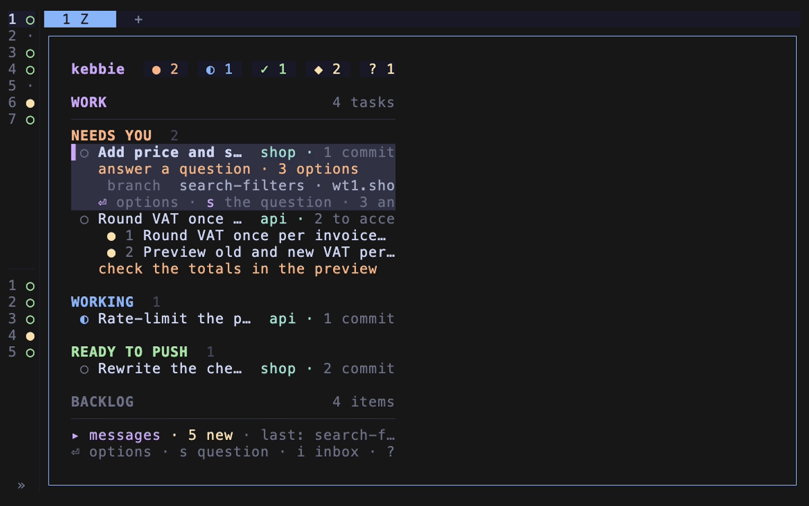

# Your first task

Install kebbie, run one task in a practice repo in its own worktree, and push it to the default branch.



It takes about twenty minutes, most of it installing tools. You need macOS or Linux and a Claude Code login.

## 1. Install the tools

kebbie runs inside [herdr](https://herdr.dev) and needs these tools on your `PATH`. Skip any you already have.

1. On macOS, install the tools:

   ```bash
   brew install herdr jq neovim curl tig
   ```

2. Install Claude Code:

   ```bash
   curl -fsSL https://claude.ai/install.sh | bash
   ```

If you are on Linux, see [Requirements](reference/requirements.md) for each tool's install command and the versions kebbie needs.

## 2. Install kebbie

1. Run the install script:

   ```bash
   curl -fsSL https://kebbie.dev/install.sh | sh
   ```

2. Confirm in herdr, which shows what the plugin will run.

The script installs the latest release as a herdr plugin with its prebuilt binary, and herdr picks the plugin up without a restart. The script then links `~/.local/share/kebbie/current` to where herdr installed it and runs setup.

If a tool from step 1 is missing, the script names it and stops.

## 3. Setup

The script opens the setup guide. Its steps are on the left; `↑` `↓` choose, `space` ticks a box, `⏎` goes on, `←` goes back, `s` skips a step and `esc` quits without writing anything.

1. **Machine name.** Keep the name it offers, or type one, such as `mac`. Your phone and your other machines show it.
2. **Agents.** Claude Code stays on. Leave Codex off for now.
3. **herdr keys.** Keep **Add them**: the three keys below go at the end of herdr's `config.toml`. A key you already use for something else is named, with a free one offered.
4. **Backlog.** Keep **Local file**: new ideas go to a `backlog.md` beside kebbie's config.
5. **Vault.** Keep **None**. [Connect the vault](how-to/connect-the-vault.md) later if you keep notes in one.
6. **Error signals.** Read what a signal holds, below, and keep them on or turn them off.
7. **Review and apply.** Read the list of what it writes and runs, then press `⏎`. The list includes the `kebbie doctor` warnings setup fixes itself, such as starting the keeper.

Each line then turns `done` or `already`, and setup ends with `Setup done` and `kebbie doctor`'s count and, under `Next steps`, what is still yours to do, such as `codex login`. Below them, **Your board on your phone** offers the hub: `h` connects now and then opens your board, any other key opens the board straight away, and `H` on the board connects later (see [See your board on your phone](how-to/see-your-board-on-your-phone.md)). It linked `~/.local/bin/kebbie` to the binary, installed the Claude Code plugin from the same folder, added the keys and reloaded herdr's config so they work. When `~/.local/bin` is not on your `PATH`, its line tells you what to add to your shell profile.

| Key | What it does |
| --- | --- |
| `prefix+space` | Goes to the lead. |
| `prefix+f` | Moves between the board and the lead's chat. |
| `prefix+t` | Opens the board. |

Updating kebbie is `U` on the board.

You can run `kebbie setup` again at any time: it starts from what this machine has and changes only what you change.

### Error signals

When kebbie itself crashes or hits some internal errors, it sends its maintainers an error signal, at most once a day. A signal holds only kebbie's version and commit, your OS and CPU architecture, the part of kebbie that failed, the kind of failure and a count. Each send is shown under messages on the board. Once a day it also sends an install signal, a random id made for this install with kebbie's version, your OS and the update channel, so the maintainers can count active installs. A bug report with text is shown to you and sent only on your `y`.

Turning them off in step 6 writes this in `~/.config/kebbie/config.toml`:

```toml
[report]
signals = false   # no error signals; text = "ask" (the default) still asks before any bug report
```

[Error signals](how-to/report-a-problem-with-kebbie.md#error-signals) says exactly what one holds.

## 4. Check the machine

1. Run the doctor:

   ```bash
   kebbie doctor
   ```

2. Read one line per check, each starting with `ok`, `warn` or `fail`:

   ```text
   ok    git                   /usr/bin/git
   ok    herdr                 0.9.5 at /opt/homebrew/bin/herdr
   ok    claude                /Users/you/.local/bin/claude
   ...
   ok    kebbie on PATH        /Users/you/.local/bin/kebbie → ...
   ```

3. Run the `fix:` line under each `warn` and `fail`, then run `kebbie doctor` again. You are done when nothing says `fail`.

## 5. Make a practice repo

kebbie pushes to a repo's remote, so the practice repo gets a remote of its own on your disk.

1. Create the repo and its remote:

   ```bash
   mkdir -p ~/code/remotes && git init --bare ~/code/remotes/hello.git
   git init ~/code/hello && cd ~/code/hello
   echo "# hello" > README.md
   git add README.md && git commit -m "Start hello"
   git branch -M main
   git remote add origin ~/code/remotes/hello.git
   git push -u origin main
   ```

## 6. Open the lead

1. In herdr, press `prefix+space`.

   kebbie creates the lead Space and moves it to the top of herdr's Spaces. On the left is the board, with the Work column, the Backlog column and the status line. On the right is the lead, a Claude that keeps track of your tasks. The Work column is empty.

2. Press `tab` on the board. Focus moves to the lead's chat, and `prefix+f` from the chat brings it back to the board.

3. Press `h` on the board. The chat hides, the board takes the whole width, and the lead keeps running. `h` again, or `tab`, brings the chat back.

## 7. Start a task

1. Open a shell in herdr and start a task from the practice repo:

   ```bash
   cd ~/code/hello
   kebbie start greet "Add a script hello.sh that prints Hello from kebbie, make it executable, and commit it."
   ```

   kebbie prints where the task went. Claude Code has not seen this folder before, so it first asks whether you trust it:

   ```text
   ! Started
     next: Once you answer, kebbie types the task's prompt in while the keeper or an open board runs.
     you: Answer greet's question in its Space: whether you trust the repo's folder.
     task: greet
     folder: /Users/you/code/wt1.hello
   ```

2. Go to the `greet` Space in herdr's sidebar and answer that you trust the folder. kebbie then types the task's prompt into Claude.

3. Look at what happened:

   - A new folder `~/code/wt1.hello` sits next to `~/code/hello`. It is a git worktree on a new branch `greet`.
   - herdr opened a Space labelled `greet`, and Claude is running in it.
   - `~/code/hello` is untouched: `git -C ~/code/hello status` is clean.

If the folder is one you already trust, the first line is `✓ Started` and Claude gets the prompt at once.

## 8. Watch it work

1. Press `prefix+space` to go back to the lead Space.

   The board lists `greet` under **Working**. Claude first makes its worktree runnable with the setup skill, then writes the script and commits it.

2. When Claude ends its turn, select the row with `↑` `↓`. The row opens with the task's report.

   At the end of a turn the task reports where it stands. The row moves to another group, and a `you:` line under it says what you should do next.

3. Wait for `greet` to move under **Ready to push**.

   When the task reports ready, kebbie checks that each commit has a subject, a blank line and a body. A read-only reviewer then checks the commits against the rules skill in the background, and the row is marked `reviewer checking rules` until it passes them. You can push before the check is done too.

## 9. Push it

1. With `greet` selected, press `p`.

   The push window opens. At the top is the task's sign-off card: what changed, where to look, and anything to confirm. Below it are the commits that will land. `↑` `↓` show each commit's full message.

2. Press `y`.

   kebbie fetches, rebases the task onto `origin/main`, pushes the commits to `main`, closes the `greet` Space and gives `wt1.hello` back to the pool. The board's Work column is empty again.

3. Check the remote:

   ```bash
   git -C ~/code/remotes/hello.git log --oneline main
   ```

   You see Claude's commit on top of `Start hello`. There was no pull request and no extra branch on the remote: the task's commit landed on `main` as it was.

## What you did

You installed kebbie's three parts, opened the board and the lead, ran one task in its own worktree and Space, and pushed it to the default branch after reading its card and commits.

Next:

- Start your next task by telling the lead what you want done, in its chat.
- [Set up a repo's worktree setup](how-to/set-up-worktrees.md) for a real project.
- Read [How kebbie fits together](explanation/architecture.md).
- Look up every key on the board in [the board reference](reference/board.md).
